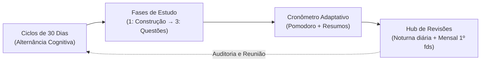

<div align="center">

# 🤝 Handshake

### **Mentor e aluno, em sincronia.**
*Plataforma de Controle e Mentoria de Estudos de Alto Rendimento baseada na Metodologia Gleyson Azevedo.*

[](https://www.typescriptlang.org/)
[](https://react.dev/)
[](https://tailwindcss.com/)
[](https://sqlite.org/)
[](https://vitest.dev/)
[](#-seguran%C3%A7a-e-conformidade-lgpd)

</div>

---

## 📖 Visão Geral

O **Handshake** é uma plataforma concebida para operacionalizar com máxima fidelidade a metodologia de estudos desenvolvida pelo mentor **Gleyson Azevedo**, aplicada à preparação de alto rendimento para os concursos públicos mais exigentes do país (como CGU, TCU, Receita Federal, Senado, BACEN, PF, etc.).

A plataforma resolve o distanciamento entre o planejamento do mentor e a execução do aluno através de:
- **Matriz de Controle de 30 Dias**: alternância visual de disciplinas, paleta de 10 cores da rodada e sincronia com reuniões semanais.
- **Ciclos e Fases Cognitivas (1 a 3)**: transição de matérias da construção teórica (*Fase 1*) até a bateria intensiva de questões (*Fase 3*).
- **Cronômetro Pomodoro Adaptativo**: início estritamente manual, resistente à navegação entre abas, com alerta sonoro suave e captura de resumos fotográficos.
- **Hub de Revisões Estruturadas**: fixação ativa noturna (pré-sono REM) e revisão mensal concentrada no 1º fim de semana do mês.
- **Parser Inteligente de Editais**: ingestão em lote de editais complexos (padrão CEBRASPE/FGV) com hierarquia profunda e filtro antiruído.
- **Segregação Rigorosa e Governança LGPD**: ambientes independentes para Mentor e Mentorado com onboarding criptografado por link de convite.

---

## 🎨 Identidade Visual e Design System

A interface do Handshake segue uma linguagem visual clean, tipográfica e funcional, inspirada em cadernos de estudo de alta precisão:

| Elemento | Especificação | Aplicação no Sistema |
|---|---|---|
| **Tipografia Display** | `Bricolage Grotesque` (`.d`) | Títulos principais, numerais de impacto e contadores |
| **Tipografia de Leitura** | `Figtree` | Corpo de texto, formulários e listas de tópicos |
| **Efeito Marca-Texto** | `.hl` (Gradiente `#FFD84D`) | Destaques conceituais e palavras-chave metodológicas |
| **Cores Institucionais** | `#14162B` (Ink Profundo) · `#4338CA` (Índigo Royal) | Cabeçalhos, botões primários e elementos de autoridade |
| **Categorias de Carga** | `#D3E3F5` (**Decoreba**) · `#FFF2CC` (**Raciocínio**) | Chips de classificação cognitiva de matérias |
| **Paleta da Rodada** | 10 tons pastéis (Coral, Âmbar, Lima, Menta, Turquesa, Azul-claro, Lavanda, Lilás, Rosa, Areia) | Pintura visual das células da matriz de 30 dias |

---

## 🧠 Os 4 Pilares da Metodologia Gleyson Azevedo



### 1. Ciclos e Matriz de 30 Dias (`ControleMatriz.tsx`)
- **Alternância Equilibrada**: slots ordenados intercalando disciplinas conceituais/normativas (*Decoreba*) com disciplinas analíticas/exatas (*Raciocínio*).
- **Cores por Rodada**: a cada passada pelo ciclo, uma nova cor da paleta é ativada.
- **Células Interativas**: o aluno clica em qualquer dia da matéria para marcar ou desmarcar o estudo realizado com feedback otimista instantâneo.
- **Dia de Corte Semanal**: destaca visualmente o dia da reunião individual com o mentor (ex: terças-feiras).

### 2. Fases de Aprendizado e Avanço Auditado
- **Fase 1 (Construção)**: Estudo (45 min) + Teste (10 min) + Recorde/Resumo (5 min) + Descanso (15 min).
- **Fase 2 (Refinamento)**: Revisão do resumo anterior (20 min) + Aplicação em questões (35 min) + Revisão final (5 min) + Descanso (15 min).
- **Fase 3 (Consolidação em Questões)**: Aplicação intensiva de 60 min direto em itens de banca.
- **Avanço Automático e Overrides**: transição acionada por aproveitamento líquido com histórico auditável de alterações manuais do mentor.

### 3. Cronômetro Inteligente com Início Manual (`SessaoEstudo.tsx`)
- **Início Estritamente Manual**: nunca dispara sozinho ao carregar a tela ou ao avançar etapas.
- **Retenção Total de Tempo**: mantido em memória no SPA via CSS (`hidden`/`block`) com backup no `localStorage`. Trocar de tela ("Edital", "Controle", "Revisões") não reinicia a contagem.
- **Áudio Harmônico**: gongo harmônico suave sintetizado nativamente via **Web Audio API** ao final de cada etapa.
- **Upload de Resumos**: compressão de fotos no cliente via HTML5 Canvas (máx 1600px, JPEG 80%).

### 4. Hub de Revisões Ativas (`RevisaoHub.tsx`)
- **Revisão Noturna (Diária)**: 15 a 20 minutos antes de dormir para percorrer a galeria de resumos produzidos no dia, sinalizando ao cérebro a prioridade de consolidação durante o sono REM. Suporte a notificações nativas às 22:00.
- **Revisão Mensal (1º Fim de Semana)**: concentrada **exclusivamente no primeiro sábado e domingo do mês**. Na matriz de controle, apenas o 1º fim de semana possui células visíveis e clicáveis; todos os outros dias permanecem em branco para evitar poluição visual.

---

## 📄 Motor de Ingestão de Editais (`parserService.ts`)

O Handshake inclui um motor exclusivo de parsing textual em lote:
- **Detecção de Grandes Blocos**: mapeia seções como `CONHECIMENTOS BÁSICOS`, `CONHECIMENTOS COMPLEMENTARES` e `CONHECIMENTOS ESPECÍFICOS`.
- **Segmentação Contextual**: identifica disciplinas pelo padrão `<NOME>:` seguido de tópicos, imune a dois-pontos secundários no meio de frases.
- **Hierarquia Numérica Profunda**: extrai com precisão níveis `1`, `1.1`, `4.2.1`, `5.3.1`, preservando a árvore recursiva pai-filho.
- **Filtro Antiruído Legislativo**: referências jurídicas como `Lei nº 12.813/2013` e `arts. 18 a 21` são mantidas no texto e **não** geram falsos tópicos numéricos.
- **Sanitização de OCR**: remoção automática de cabeçalhos de banca, paginação e reparo de palavras coladas (`daTransparência` → `da Transparência`).

---

## 🏛️ Arquitetura Técnica

```
handshake/
├── src/
│   ├── client/                  # Aplicação Frontend SPA (React 19 + Tailwind v4)
│   │   ├── components/
│   │   │   ├── auth/            # LoginView, ConviteAceitarView
│   │   │   ├── common/          # Header, Sidebar, BottomNav, Logo
│   │   │   ├── landing/         # LandingPage pública institucional
│   │   │   ├── mentor/          # MentorPainel, EstruturaEdital, EditalParser, PlanejarCiclo, ConvitesGerenciar
│   │   │   └── mentorado/       # SessaoEstudo, ControleMatriz, EditalAluno, RevisaoHub
│   │   ├── theme/               # Tokens de cores, paleta da rodada
│   │   ├── App.tsx              # Roteamento seguro, controle de sessão e layout
│   │   └── main.tsx
│   ├── server/                  # Backend Node.js / Express
│   │   ├── db/                  # SQLite schema, database helper, seed
│   │   ├── routes/              # api.ts (rotas RESTful)
│   │   ├── services/            # authService, parserService, cycleService, aggregationService, auditService
│   │   └── index.ts             # Servidor Express e inicialização
│   └── shared/
│       └── types.ts             # Modelos e interfaces compartilhados
├── tests/                       # Suíte de Testes Automatizados Vitest
│   ├── authService.test.ts
│   ├── controle_matriz.test.ts
│   ├── parserService.test.ts
│   ├── edital_lote.test.ts
│   ├── edital_cobranca.test.ts
│   ├── auditService.test.ts
│   ├── cycleService.test.ts
│   └── aggregationService.test.ts
├── data/                        # handshake.db (SQLite)
├── dist/                        # Bundle de produção (Vite + tsc)
└── package.json
```

---

## 🔑 Credenciais de Acesso (Ambiente de Homologação)

| Perfil | E-mail / Identificador | Senha Padrão | Funcionalidades Habilitadas |
|---|---|---|---|
| **Mentor Oficial** | `gleysonazevedo@gmail.com` | `Gleyson!Handshake01` | Gestão de Mentorados, Editais, Ciclos, Parser e Convites |
| **Mentorado Convidado** | E-mail do convite | Definida no Onboarding | Hoje (Cronômetro), Edital, Controle e Revisões |
| **Mentorado Demo 1** | `marina@handshake.local` | `Aluno!123456` | Aluna ativa com histórico populado no concurso da CGU |
| **Mentorado Demo 2** | `rafael@handshake.local` | `Aluno!123456` | Aluno ativo em fase de construção |
| **Mentorado Demo 3** | `lucas@handshake.local` | `Aluno!123456` | Aluno em fase de refinamento |

---

## 🔒 Segurança e Conformidade LGPD

- **Hashing Criptográfico**: derivação de chaves via `crypto.scryptSync` com salt aleatório de 16 bytes. Nenhuma senha trafega ou é gravada em texto puro.
- **Sessões no Banco**: tokens criptográficos UUIDv4 com expiração de 30 dias na tabela `sessao_auth`, com revogação instantânea no logout.
- **Consentimento Explícito (HU-1.2)**: o link de convite (`/convite?token=...`) exige leitura e aceite do termo de privacidade antes da ativação, gravando o carimbo de data/hora (`consentimento_em`).
- **Direito ao Esquecimento (HU-1.6 / HU-1.7)**: endpoint `/api/usuarios/excluir` para eliminação segura de dados pessoais e fotos de resumos no servidor.

---

## 🚀 Como Executar o Projeto Localmente

### Pré-requisitos
- **Node.js** >= 20.0.0
- **npm** >= 10.0.0

### 1. Clonar e Instalar Dependências
```bash
git clone <url-do-repositorio>
cd handshake
npm install
```

### 2. Popular o Banco de Dados (Seed Inicial)
Popula o SQLite com o mentor oficial (`gleysonazevedo@gmail.com`), os alunos de teste, o edital estruturado da CGU e a matriz de controle de 30 dias:
```bash
npm run seed
```

### 3. Iniciar o Servidor de Desenvolvimento
```bash
npm run dev
```
Acesse a aplicação no navegador em: **`http://localhost:3001`**.

---

## 🧪 Suíte de Testes Automatizados

O projeto conta com **30 testes automatizados** de unidade e integração utilizando o **Vitest**, cobrindo todas as regras de negócio críticas:

```bash
npx vitest run --no-file-parallelism
```

### Resumo dos Testes:
- `tests/authService.test.ts`: Hashes scrypt, login de mentor/aluno, convites, tokens e magic links.
- `tests/controle_matriz.test.ts`: Marcação/desmarcação de células, cálculo do 1º fds do mês e revisões.
- `tests/parserService.test.ts`: Extração CEBRASPE, hierarquia de tópicos, limpeza de ruídos e palavras coladas.
- `tests/edital_lote.test.ts`: Inserção atômica em lote no SQLite com transação.
- `tests/edital_cobranca.test.ts`: Pontuação líquida (fator de penalidade Cespe vs múltipla escolha).
- `tests/cycleService.test.ts`: Distribuição equilibrada de Decoreba e Raciocínio nos ciclos.
- `tests/aggregationService.test.ts`: Agregação de acertos de folhas para pais e avanço de fase.
- `tests/auditService.test.ts`: Auditoria de alterações manuais de fase pelo mentor.

---

## 📦 Compilação de Produção

Para validar a tipagem e gerar o pacote compilado:
```bash
npm run build
```
Executa `vite build` (gerando os assets otimizados em `dist/`) e `tsc -p tsconfig.server.json` (compilação TypeScript do backend).

---

## 📄 Licença

Este projeto é desenvolvido para aplicação exclusiva da **Metodologia Gleyson Azevedo**. Todos os direitos reservados.
